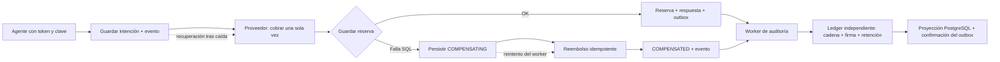

# Laboratorio completo de reservas, pagos y auditoría

Esta implementación original, incluida bajo MIT, permite repetir el ejercicio desde un clon público. Requiere **Python 3.11+, Git y Docker Engine** con acceso al daemon; usa PostgreSQL real y dos instancias de una API Python. El simulador HTTP de pagos guarda cargos y reembolsos en PostgreSQL; todos los importes y las identidades son sintéticos.

## Ejecutar desde cero

En Linux, macOS con Docker o AWS CloudShell con Docker disponible:

```bash
git clone https://github.com/sjaramillov/agentic-transformation-workshop-latam.git
cd agentic-transformation-workshop-latam
python3 booking_lab/run.py e2e --output .local/db-e2e.json
```

Docker instala las dependencias y descarga las imágenes fijadas en `booking_lab/images.lock.json`. Reserva al menos **4 GiB de disco libre y 1.5 GiB de memoria** para una ejecución. Si usas CloudShell con driver `vfs`, sigue la [limpieza de contenedores detenidos](CLOUDSHELL.md) antes de repetir para recuperar espacio.

**Éxito:** el proceso termina con código 0, cada caso imprime `PASS`, `result` es `passed` y todas las invariantes de `.local/db-e2e.json` valen cero. Un fallo termina con código distinto de cero y conserva los logs.

El runner crea nombres únicos, descubre puertos libres y publica la API en `127.0.0.1`. PostgreSQL y pagos están en una red Docker interna sin puertos publicados. Usa contraseñas aleatorias y credenciales distintas por servicio; los archivos `.env` privados tienen modo 0600. Al terminar detiene únicamente sus contenedores y conserva el volumen, el dump y los logs en `.local/db-lab-*/` para revisión. Repetir el comando crea un laboratorio nuevo.

## Explorar el servicio manualmente

Para el recorrido con planificación, aprobación y recuperación usa primero el [agente ejecutable](AGENTE_EJECUTABLE.md). El cliente de operador de esta sección también pide aprobación antes de crear o cancelar; ambos llaman al mismo contrato de API.

En una primera terminal inicia la demo:

```bash
python3 booking_lab/run.py demo --output .local/demo.json
```

Espera `DEMO_READY`. Copia la ruta `session=...` en una segunda terminal del mismo host. Esa sesión es un fixture privado del operador del laboratorio; el cliente genera tokens efímeros y nunca los imprime.

```bash
export DEMO_SESSION=/ruta/mostrada/session.json
python3 booking_lab/client.py --session "$DEMO_SESSION" create --key reserva-001
python3 booking_lab/client.py --session "$DEMO_SESSION" list
python3 booking_lab/client.py --session "$DEMO_SESSION" --subject agent-b list
# Copia el id de la reserva de agent-a:
python3 booking_lab/client.py --session "$DEMO_SESSION" cancel ID_DE_RESERVA
```

Antes de cada escritura el cliente muestra la acción y pide `APROBAR <digest>`. Repite `create` con la misma clave y cuerpo para observar el replay. Cambia `--amount` con la misma clave y aprueba esa propuesta para recibir 409. La lista de agent-b no muestra reservas de agent-a. Termina con Ctrl+C en la primera terminal; los contenedores se detienen y sus datos quedan disponibles para revisión. La demo es interactiva; el comando `e2e` produce la evidencia automatizada.

## Integridad y atribución

| Control | Implementación | Comportamiento esperado |
| --- | --- | --- |
| Atribución y durabilidad | Token firmado validado; principal y correlación persistidos; evento outbox en la misma transacción que el cambio; entrega idempotente a ledger independiente firmado y proyección PostgreSQL; runtime sin UPDATE/DELETE | Identidad cruzada rechazada, evento atribuible, permiso de entrega retirado, reinicio del worker, cola drenada y redelivery sin duplicados |
| Recuperación de pagos | Intención guardada antes del cobro, clave estable en el proveedor, estado COMPENSATING persistido, refund idempotente y reconciliador | Trigger PostgreSQL hace fallar realmente el INSERT después del cobro; no queda reserva ni cargo huérfano; reembolso caído se recupera; proceso muerto después del cobro no duplica cargos y proceso muerto después del reembolso no duplica devoluciones |

La reserva, su respuesta de idempotencia y su evento se confirman en una transacción PostgreSQL. El cobro es una transacción externa del simulador. La recuperación y las claves idempotentes coordinan ambas operaciones y resuelven reintentos. Un fallo ambiguo de COMMIT exige volver a leer el estado antes de reembolsar.



## Contrato de la API

| Método y ruta | Scope | Resultado |
| --- | --- | --- |
| GET `/health/live` | Público local | Proceso atiende |
| GET `/health/ready` | Público local | DB y tabla de operaciones accesibles; 503 si fallan |
| POST `/bookings` | `bookings:write` | `{"itinerary":"BOG-MDE","amount":12500}`; requiere `Idempotency-Key` y `X-Booking-Approval`; 201 al confirmar |
| GET `/bookings` | `bookings:read` | Solo reservas del principal autenticado |
| GET `/bookings/{id}` | `bookings:read` | Detalle propio o 404 |
| DELETE `/bookings/{id}` | `bookings:cancel` | Requiere su propia `X-Booking-Approval`; cancelación y reembolso idempotente |

`amount` es entero en unidades mínimas de la moneda del laboratorio. Una clave se delimita por principal y operación; el cuerpo se canoniza y compara por hash. Cambiar el cuerpo con la misma clave da 409. La misma solicitud enviada en paralelo a dos instancias produce una reserva y un cobro. Se conserva la respuesta original del POST después de cancelar; GET muestra el estado actual.

El emisor del laboratorio firma tokens HS256 de cinco minutos con clave aleatoria. La API comprueba firma, algoritmo, issuer, audience, caducidad, activación y scope; no tiene un modo de autenticación desactivada. Este emisor es un fixture local. Una integración externa requiere un proveedor de identidad, gestión de claves, TLS e ingress apropiados. El servidor HTTP de Python es un runtime didáctico; la prueba en CloudShell no certifica exposición pública ni alta disponibilidad.

Además, la API exige una aprobación firmada para cada escritura. [approval.py](booking_lab/approval.py) vincula sujeto, método, ruta, hash del payload y clave idempotente, con vigencia máxima de cinco minutos y clave distinta a JWT. Una autorización ausente, vencida, alterada o dirigida a otra operación devuelve 403 antes de crear intención/cobro. La sesión del operador emite estas aprobaciones para la práctica. Las llamadas HTTP de cliente, pagos y auditoría rechazan redirecciones y no heredan proxies del sistema.

## Revisar la evidencia y continuar

[booking_lab/run.py](booking_lab/run.py) deja la lista de casos, versiones, digests de imágenes resueltos, hashes del código, resultado de restauración y conteos finales. [schema.sql](booking_lab/schema.sql) permite revisar permisos y restricciones, y [service.py](booking_lab/service.py) contiene la saga y el outbox.

El archivo `review.json` privado identifica el prefijo del laboratorio y sus puertos. Los logs y el dump contienen solo los datos sintéticos de la ejecución. Las credenciales de los archivos `.env` son locales y no deben subirse a Git. Guarda el directorio privado si necesitas retomar la sesión. Para volver a probar desde cero utiliza el comando inicial; no hace falta borrar un laboratorio anterior.

El registro de auditoría autoritativo vive en un servicio y volumen separados, con cadena de hashes y firmas HMAC; PostgreSQL conserva una proyección consultable. El administrador de la DB de reservas no recibe el volumen ni la clave del ledger. La retención, verificación y frontera de confianza están descritas en [AUDIT.md](booking_lab/AUDIT.md). El outbox conserva eventos durante una caída del destino; una caída permanente requiere intervención operativa. El reconciliador debe ejecutarse para resolver estados pendientes, y las garantías del proveedor real deben verificarse antes de sustituir el simulador.

Para evaluar tus cambios con ARA/MODA, sigue [Ejecución AWS](EJECUCION_AWS.md). Para comprobar la aplicación, consulta [Pruebas del workshop](AUDITORIA_E2E.md).

## Ejecutar en CloudShell y conservar datos

Sigue [CloudShell](CLOUDSHELL.md) para preparar el entorno y gestionar el disco. El runner adapta los límites de recursos a las capacidades del daemon y descubre los puertos después de cada reinicio; `review.json` registra los puertos vigentes.

Los volúmenes dependen del almacenamiento del daemon. Descarga el dump si necesitas conservar los datos al terminar la sesión. El E2E restaura seis tablas en una DB distinta; para una instalación nueva también debes ejecutar el bootstrap de roles y el esquema.

La prueba de restauración detiene las API, drena operaciones y auditoría y detiene los escritores antes de `pg_dump`. Así compara el backup con una base estable.

Referencias: [transacciones de Psycopg](https://www.psycopg.org/psycopg3/docs/basic/transactions.html), [bloqueos PostgreSQL](https://www.postgresql.org/docs/16/explicit-locking.html) y [pg_dump](https://www.postgresql.org/docs/16/app-pgdump.html).
