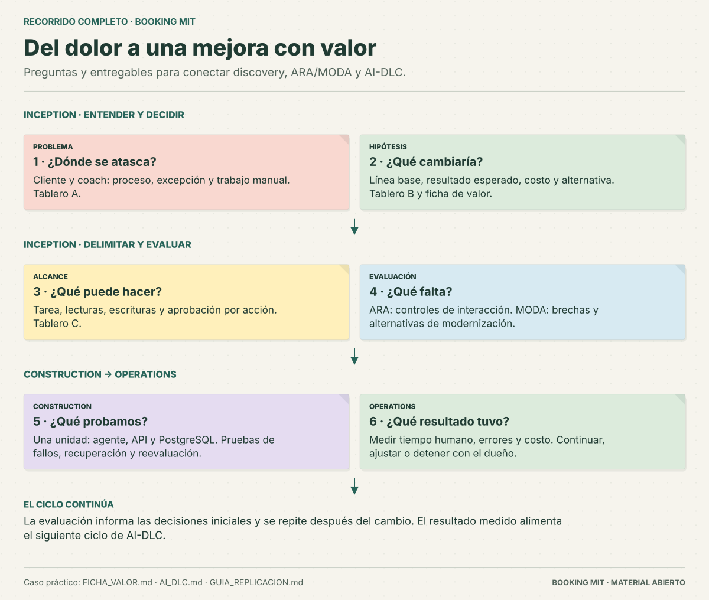

# Agentic Transformation Workshop AWS Guide

Laboratorio práctico en español para conectar **una oportunidad de negocio, un agente ejecutable y evidencia técnica**. Incluye ficha de valor, integración con AI-DLC, PostgreSQL, pagos simulados, ARA/MODA y seis tableros tipo post-it. El código, las pruebas, las guías y los diagramas originales están disponibles bajo MIT.

## Del problema a una decisión comprobable

1. Completa la **[ficha de valor](FICHA_VALOR.md)**: problema, métrica, alternativas, responsable y criterio para continuar o detenerse.
2. Organiza requisitos, construcción y operación con la **[integración de AI-DLC](AI_DLC.md)**.
3. Ejecuta el **[agente de reservas](AGENTE_EJECUTABLE.md)**: proponer → aprobar → llamar herramientas → observar → recuperar.
4. Evalúa preparación técnica con ARA/MODA y enlaza cada cambio con sus pruebas y la métrica de negocio pendiente de medir.

El modo predeterminado usa un planificador determinista para facilitar la reproducción. Incluye un adaptador opcional a Bedrock para proponer acciones desde lenguaje natural; ambos usan el mismo controlador y la aprobación que verifica la API.

## Ejecuta la réplica completa

```bash
git clone https://github.com/sjaramillov/agentic-transformation-workshop-latam.git
cd agentic-transformation-workshop-latam
python3 booking_lab/run.py e2e --output .local/db-e2e.json
```

Necesitas Python 3.11+ y Docker en Linux/macOS; en Windows, WSL con Docker accesible. El comando crea la DB y dos instancias de API, ejecuta también la CLI del agente, prueba fallos y aprobaciones, guarda evidencia y detiene sus contenedores. **Todo el código necesario está en este repo público.** Lee [el inicio rápido](INICIO_RAPIDO.md) y [el laboratorio MIT](LABORATORIO_MIT.md).

## Empieza aquí

- **[Laboratorio completo MIT](LABORATORIO_MIT.md)**: flujo con PostgreSQL y pruebas desde un clon público.
- [Agente ejecutable](AGENTE_EJECUTABLE.md): demo interactiva, aprobación, reanudación y Bedrock opcional.
- [Ficha de valor](FICHA_VALOR.md) y [AI-DLC](AI_DLC.md): ejemplo resuelto, plantillas y entregables por fase.
- [Ejemplo generado visible](examples/workshop/README.md): ficha, matriz y entregas de AI-DLC para leer sin ejecutar comandos.
- [Inicio rápido](INICIO_RAPIDO.md): clona y ejecuta el workshop público completo.
- [Auditoría E2E](AUDITORIA_E2E.md): capas de verificación y evidencia.
- [Ejecución AWS](EJECUCION_AWS.md): acceso, rutas, publicación de TD y aceptación.
- [Pruebas del contenedor](RUNTIME_LOCAL.md): detectar y corregir fallos de empaquetado y sondas.
- [Preparación con CloudShell](CLOUDSHELL.md): recorrido comprobado para una cuenta propia.
- [Revisión de las TD](LIMITACIONES_TD.md): criterios para aceptar una remediación.
- [Guía de réplica](GUIA_REPLICACION.md): requisitos, secuencia de módulos, comandos y puntos de verificación.
- [Tableros visuales](diagramas/README.md): seis diagramas originales tipo post-it sobre el flujo y sus controles.
- [Prompts reutilizables](PROMPTS.md): mapeo, priorización y comparación con evidencia.
- [Fuentes y recursos](RECURSOS.md): páginas del evento y referencias de AWS/Kiro.
- [Alcance de licencias y atribución](NOTICE.md).

## Estado de reproducción

La versión actual pasó **112 pruebas automatizadas**, **28/28 escenarios E2E con PostgreSQL en dos ejecuciones independientes** y los seis trabajos de CI. Además, desde un clon público en **CCS**, el agente pasó **7/7 casos con cuatro inferencias reales de Amazon Nova Micro en Bedrock**: rechazo por importe ausente, creación, consulta, cancelación, aprobaciones, recuperación y restauración. La [evidencia Bedrock](evidence/bedrock/README.md) conserva el fallo inicial, la corrección y la ejecución aceptada con sus commits y hashes. La [evidencia determinista anterior](evidence/agent-workshop/README.md), la [auditoría E2E](AUDITORIA_E2E.md) y el [laboratorio completo](LABORATORIO_MIT.md) explican las capas y cómo repetirlas.

Como referencia fechada, la versión del **16 de octubre de 2026** pasó **18 escenarios E2E en CCS** y ARA pasó de **1 a 0 bloqueadores**, con clasificación **Pilot-Ready (Safety Concerns)**. La [comparación ARA/MODA](CCS_E2E.md) y la [evidencia de DB](CCS_DATABASE_E2E.md) conservan sus commits y riesgos. Los informes corresponden a esa versión; los nuevos controles del agente requieren una nueva evaluación para atribuirles cierres ARA/MODA.

## Tableros




## Recorrido resumido

1. Formular la hipótesis de valor y modelar la experiencia y sus excepciones (0–A).
2. Decidir dónde un agente puede aportar valor, elegir autonomía y ejecutar el flujo aprobado (B–C).
3. Evaluar seguridad para agentes con ARA y rutas de modernización con MODA (D–E); ampliar al portafolio si hace falta (F).
4. Priorizar con evidencia y aplicar cambios revisables en una rama local (G–H).
5. Repetir análisis con el mismo alcance y operar el ciclo con dueños y controles claros (I–J).

Los diagramas son esquemas explicativos, no reproducciones literales de los tableros del evento ni reportes de métricas. Sus decisiones siguen los ejemplos descritos en la guía.

## Materiales incluidos

Código de aplicación y agente, esquema PostgreSQL, pruebas, ficha de valor, escenario, ejercicios A–C, entregables de AI-DLC, contextos ARA/MODA, transformación original y plantillas de comparación. Genera una práctica con:

```bash
python3 scripts/workshop.py prepare --output .local/workshop-01
```

El preparador extrae todos los insumos del mismo commit; los cambios sin commit quedan fuera de la instantánea. La [guía A–J](GUIA_REPLICACION.md) enlaza cada paso con su recurso público. Los análisis administrados D–I requieren tu cuenta y acceso a AWS Transform; el agente determinista y el E2E funcionan sin credenciales AWS. Los documentos de la primera implementación están en [el archivo histórico](historico/README.md).

## Fuentes

El taller original está en [AWS Workshop Studio](https://catalog.us-east-1.prod.workshops.aws/event/dashboard/en-US/workshop). La lista completa de módulos y referencias está en [RECURSOS.md](RECURSOS.md). El repositorio público complementario de AWS es [sample-agentic-readiness-analysis-orchestrator](https://github.com/aws-samples/sample-agentic-readiness-analysis-orchestrator); no está copiado dentro de este repositorio.

## Licencia

El código original de la réplica, sus pruebas, scripts, guía y diagramas se distribuyen bajo [MIT](LICENSE). Las referencias a proyectos externos se identifican en [NOTICE.md](NOTICE.md).
