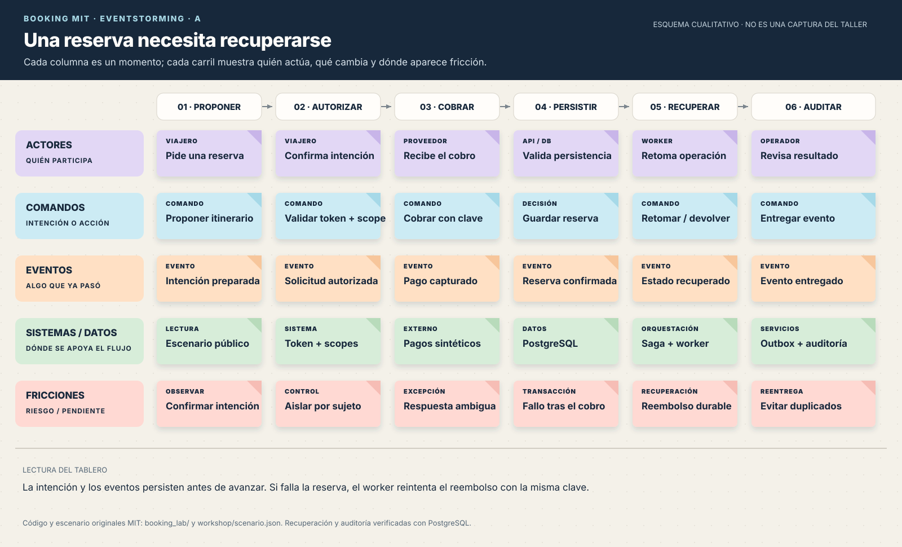
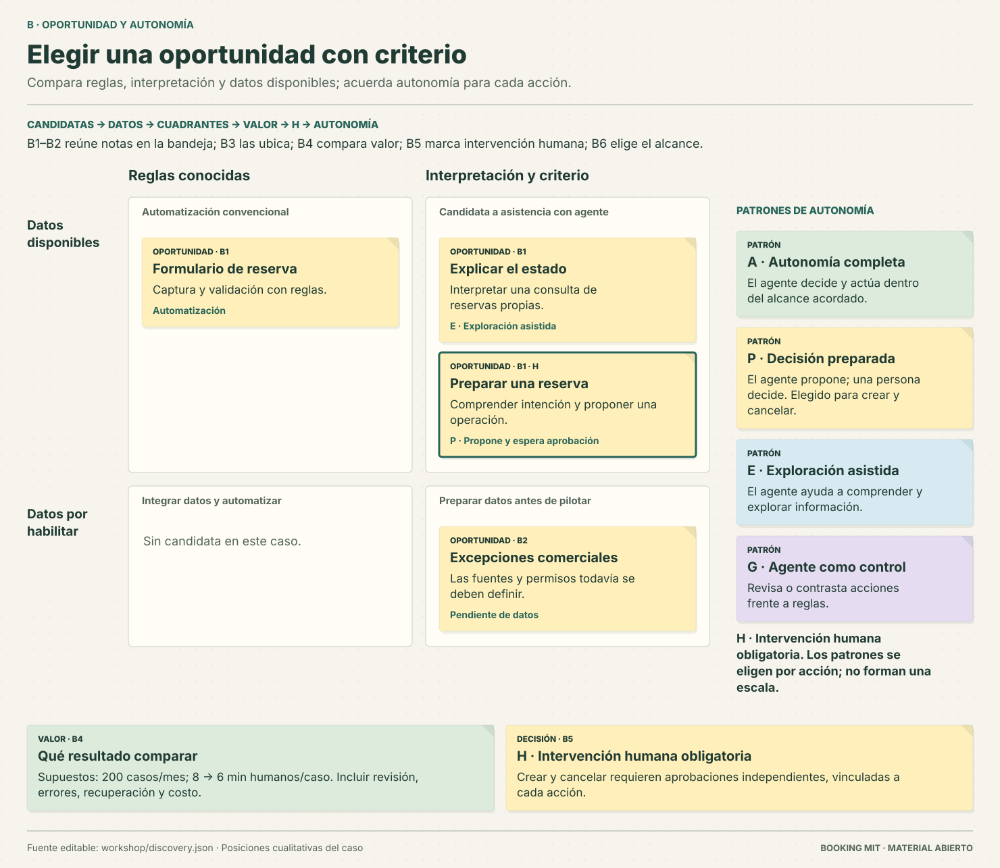
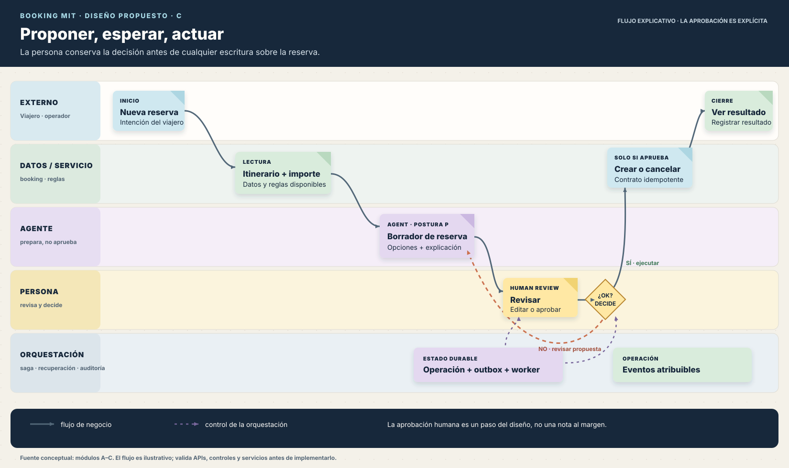
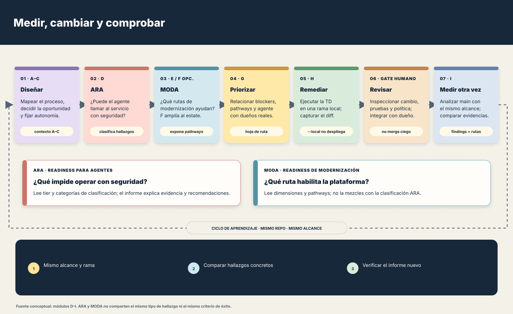
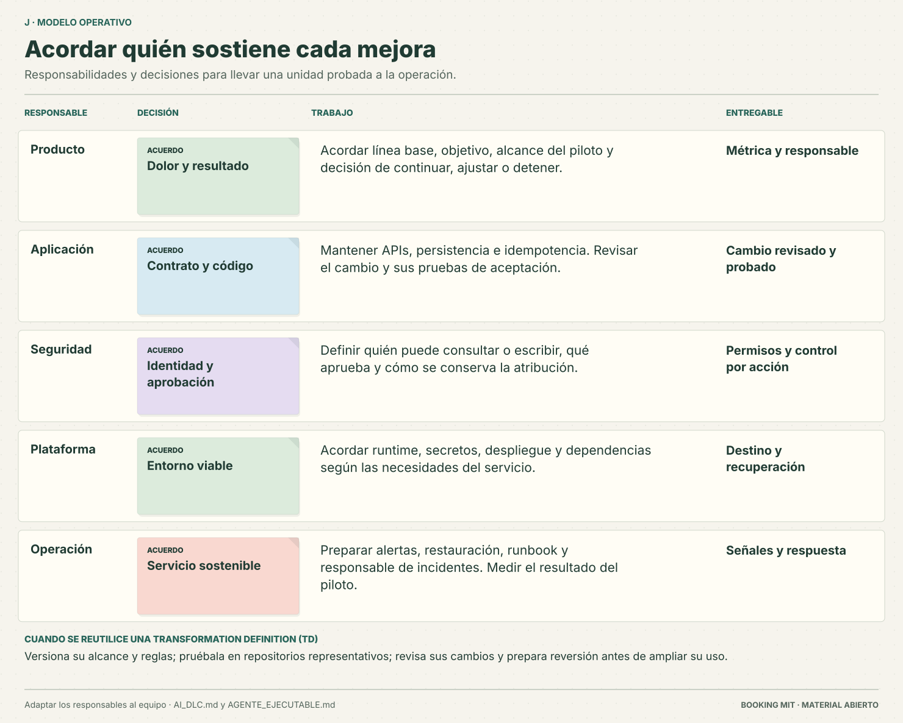

# Agentic Transformation Workshop AWS Guide

Una guía práctica, en español, para estudiar y volver a recorrer el taller de AWS sobre preparación de servicios para agentes: EventStorming, diseño del agente, ARA/MODA, priorización, remediación controlada y nueva medición.

> **Alcance de la licencia:** MIT cubre la guía resumida y los diagramas originales de este repositorio. El paquete de código del evento se conserva localmente, pero no se publica porque no encontramos una licencia de redistribución para los ejemplos TravelCorp. Las páginas de AWS y el repositorio de AWS Samples se rigen por sus propios términos.

## Empieza aquí

- **[Inicio rápido y práctica offline](INICIO_RAPIDO.md)**: restaura el paquete y recorre A–C sin AWS.
- [Auditoría E2E](AUDITORIA_E2E.md): correcciones, evidencia y pruebas pendientes.
- [Ejecución AWS](EJECUCION_AWS.md): acceso, rutas, publicación de TD y aceptación.
- [Pruebas del contenedor](RUNTIME_LOCAL.md): detectar y corregir fallos de empaquetado y sondas.
- [Preparación con CloudShell](CLOUDSHELL.md): recorrido comprobado para una cuenta propia.
- [Revisión de las TD](LIMITACIONES_TD.md): problemas de los ejemplos y criterios para aceptar una remediación.
- [Guía de réplica](GUIA_REPLICACION.md): requisitos, secuencia de módulos, comandos y puntos de verificación.
- [Tableros visuales](diagramas/README.md): cinco diagramas originales tipo post-it sobre el flujo y sus controles.
- [Prompts reutilizables](PROMPTS.md): mapeo, priorización y comparación con evidencia.
- [Fuentes y recursos](RECURSOS.md): páginas del evento y referencias de AWS/Kiro.
- [Alcance de licencias y atribución](NOTICE.md).

## Estado de reproducción

La restauración y el recorrido offline A–C se verifican con la captura real. También se ejecutaron análisis nuevos en una cuenta propia y se probaron contenedores generados por AWS Transform: aparecieron fallos que el estado `completed` no detectaba. Consulta [la evidencia de CCS](CCS_E2E.md), las correcciones reproducibles y los límites de aceptación; una clasificación del analizador no certifica un despliegue.

## Tableros

## Recorrido resumido

1. Modelar la experiencia y sus excepciones (A).
2. Decidir dónde un agente aporta valor y qué autonomía puede tener (B–C).
3. Evaluar seguridad para agentes con ARA y rutas de modernización con MODA (D–E); ampliar al portafolio si hace falta (F).
4. Priorizar con evidencia y aplicar cambios revisables en una rama local (G–H).
5. Repetir análisis con el mismo alcance y operar el ciclo con dueños y controles claros (I–J).

Los diagramas son esquemas explicativos, no reproducciones literales de los tableros del evento ni reportes de métricas. Sus decisiones siguen los ejemplos descritos en la guía.

## Límites para repetir el laboratorio

El evento usaba una cuenta temporal y recursos preaprovisionados. Esta guía documenta el recorrido, pero no despliega infraestructura ni sustituye las instrucciones vigentes de AWS para una cuenta propia. Revisa permisos, regiones, disponibilidad de servicios y precios antes de ejecutar los comandos. El paquete de código del evento y los informes capturados siguen en la carpeta local original y no están incluidos en este repo público.

## Fuentes

El taller original está en [AWS Workshop Studio](https://catalog.us-east-1.prod.workshops.aws/event/dashboard/en-US/workshop). La lista completa de módulos y referencias está en [RECURSOS.md](RECURSOS.md). El repositorio público complementario de AWS es [sample-agentic-readiness-analysis-orchestrator](https://github.com/aws-samples/sample-agentic-readiness-analysis-orchestrator); no está copiado dentro de este repositorio.

## Licencia

La guía y los diagramas originales se distribuyen bajo la licencia [MIT](LICENSE), dentro del alcance explicado en [NOTICE.md](NOTICE.md).
