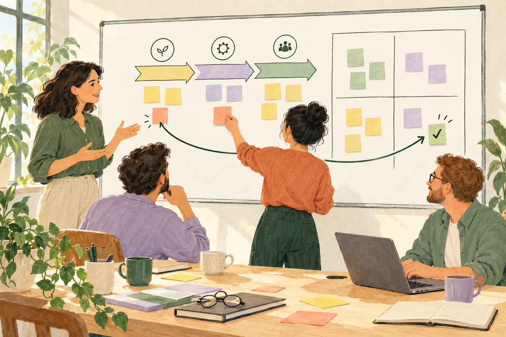
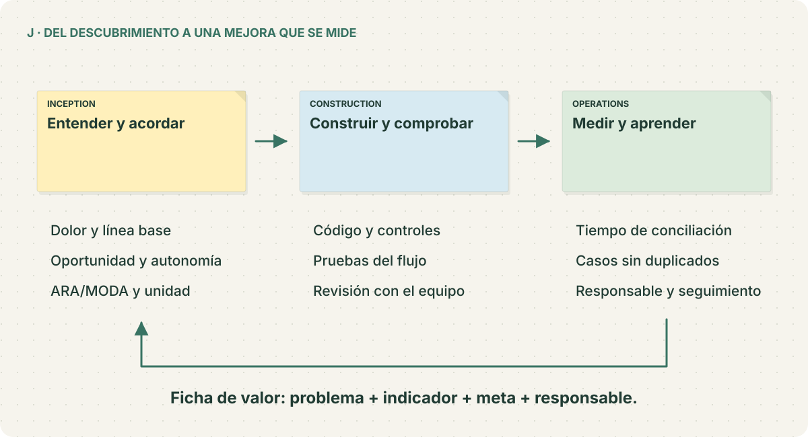

# Agentic Transformation Workshop

[](https://github.com/sjaramillov/agentic-transformation-workshop-latam/actions/workflows/checks.yml?query=branch%3Amain)

**Escucha al cliente, descubre el dolor del proceso y construye una oportunidad de agente con sentido.** Un workshop en español con preguntas predefinidas, cliente simulado, coach y tres tableros de post-it que se forman mientras avanzas.

Después conectarás esas decisiones con ARA/MODA, ejecutarás un agente de reservas y llevarás el trabajo a AI-DLC. Todo el código y los materiales originales están incluidos bajo **MIT**.

[](https://sjaramillov.github.io/agentic-transformation-workshop-latam/)

**[Empezar la práctica web](https://sjaramillov.github.io/agentic-transformation-workshop-latam/practica/)** · [Presentación visual](https://sjaramillov.github.io/agentic-transformation-workshop-latam/) · [Tableros completos](https://sjaramillov.github.io/agentic-transformation-workshop-latam/diagramas/) · [Guía paso a paso](GUIA_REPLICACION.md)

## Empieza con una reunión

Abre la **práctica web**, elige la pregunta que harías al cliente y escucha su respuesta y al coach. Los post-it aparecen mientras avanzas por las **21 situaciones**. Solo necesitas un navegador: no hay que clonar el repo, instalar Python ni configurar AWS.

El avance se guarda automáticamente en ese navegador. En **Tu avance** puedes descargarlo, cargarlo en otro equipo o iniciar otra práctica. Al terminar tendrás tu conversación, los tres tableros y los contextos para ARA/MODA.

**Continúa con la [guía paso a paso](GUIA_REPLICACION.md).** La [presentación visual](https://sjaramillov.github.io/agentic-transformation-workshop-latam/) ofrece ocho láminas ilustradas para presentar el recorrido, con impresión a PDF.

<details>
<summary>También puedes practicar localmente</summary>

Con Git, Python 3.11+ y un navegador, en Linux, macOS o WSL:

```bash
git clone https://github.com/sjaramillov/agentic-transformation-workshop-latam.git
cd agentic-transformation-workshop-latam
python3 scripts/facilitate.py
```

Abre la URL que imprime la terminal. El mismo comando retoma la sesión. Esta alternativa usa las mismas preguntas y los mismos tableros.

</details>

## Así se construye el workshop

| Etapa | Lo que harás | Lo que aparece en el tablero |
| --- | --- | --- |
| A · Entender el proceso | 9 situaciones, empezando por un caso que le duele al cliente | Eventos en orden; personas, comandos, información, reglas y dolores bajo cada paso |
| B · Elegir la oportunidad | 6 situaciones para comparar alternativas y acordar autonomía | Cuadrantes de criterio y disponibilidad de datos; post-it que se ubican al investigar |
| C · Diseñar el flujo | 6 situaciones sobre intención, herramientas, aprobación y recuperación | Carriles de persona, agente, datos y sistemas; acciones y consultas de la API |
| D–I · Evaluar y mejorar | Leer informes de referencia o ejecutar ARA/MODA en tu cuenta | Hallazgo → cambio → prueba → comparación |
| J · Llevarlo al equipo | Conectar el caso con [AI-DLC](AI_DLC.md) | Requisitos, responsables y medición de valor |

El cliente y el coach tienen respuestas preparadas. Cada elección recibe feedback; la síntesis común permite completar el caso aunque una pregunta no haya sido la recomendada. Puedes consultar y adaptar las [21 situaciones](workshop/discovery.json), ver la [conversación resuelta](examples/discovery/conversacion.md) o descargar los [tableros completos](examples/discovery/tableros.html).

## Del tablero a un agente funcionando



La [guía](GUIA_REPLICACION.md#6-ejecuta-el-agente-y-comprueba-el-flujo-h) te lleva a una API con PostgreSQL, aprobación humana, pagos sintéticos y recuperación de operaciones. Para esta etapa necesitas Docker. Bedrock y AWS Transform son extensiones con tu cuenta AWS.

- [Demo interactiva del agente](AGENTE_EJECUTABLE.md).
- [Ejecutar ARA/MODA](EJECUCION_AWS.md) y [preparar CloudShell](CLOUDSHELL.md).
- [Ficha de valor](FICHA_VALOR.md) e [integración con AI-DLC](AI_DLC.md).
- [Habilidades abiertas ARA/MODA](https://github.com/sjaramillov/aws-ara-moda-skills): instalación, metodología y ejemplos para tu agente.
- [Recursos y fuentes](RECURSOS.md), [diagramas de apoyo](diagramas/README.md) y [validación](evidence/README.md).

## Licencia

Proyecto independiente inspirado en el Agentic Transformation Workshop de AWS. Código, preguntas, coach, tableros y guías originales bajo [MIT](LICENSE). [Autoría y referencias](NOTICE.md).
